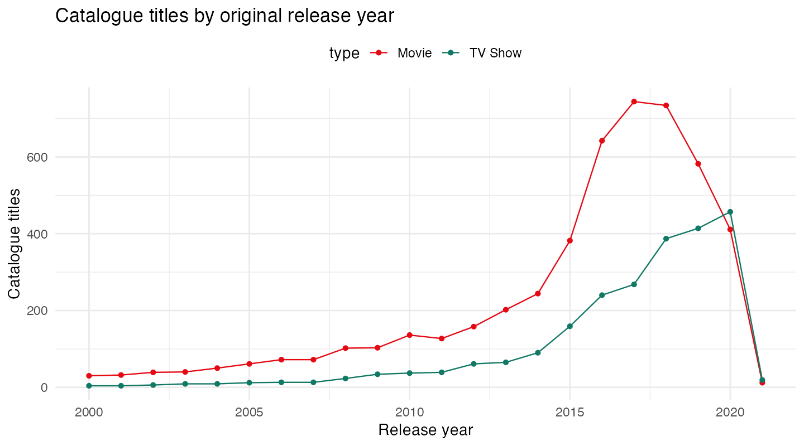

# A first look at data with R
### Films, TV shows, and your first data story.

  

I wrote this as a free introduction to coding for CodeClan. It takes you from opening RStudio to exploring a real dataset and making your first chart. No previous coding experience needed.

**[Start the lesson →](intro_r_netflix.Rmd)** · [Download the rendered HTML](intro_r_netflix.html) · [Get the data](data/netflix.csv)



> **The question matters.** These are catalogue entries, not viewing figures. We can compare the titles in this snapshot; we cannot use them to measure audience popularity.

## What you'll learn

| Start here | Then try | Leave with |
|---|---|---|
| Find your way around RStudio | Read a CSV and inspect its columns | A table you can explain |
| Work with functions and objects | Filter, group and summarise with dplyr | A repeatable analysis pipeline |
| Read a data pipeline | Build a chart with ggplot2 | Your first data story |

## Try it locally

1. Install R and RStudio, then download or clone this repository.
2. Open `mini_taster.Rproj`.
3. In the R console, install the lesson packages:

```r
install.packages(c("tidyverse", "rmarkdown"))
```

Open `intro_r_netflix.Rmd` and run each code chunk as you go. To read without coding, download `intro_r_netflix.html` and open it in your browser.

To rebuild the HTML lesson, run this from the project folder:

```r
rmarkdown::render("intro_r_netflix.Rmd", output_format = "html_document")
```

Rendering needs Pandoc, which is included with RStudio. The source and HTML were rerun during the 2026 refresh with R 4.4.1.

## About the data

The bundled [TidyTuesday snapshot from 20 April 2021](https://github.com/rfordatascience/tidytuesday/tree/main/data/2021/2021-04-20) contains **7,787 titles**: 5,377 films and 2,410 TV shows, with original release years from 1925 to 2021. It is a historical snapshot, not Netflix's current catalogue.

The lesson focuses on titles released from 2000 onwards. Original release year, date added to Netflix and viewing popularity are different things.

## Make it your own

- Repeat the chart for titles released from 2010 onwards.
- Find the busiest original release year for films and for TV shows.
- Write two sentences explaining what the data can tell you, and one thing it cannot.

<details>
<summary><strong>For instructors</strong></summary>

The lesson includes instructor notes and illustrations for the RStudio interface, functions, pipes and plotting. Use the questions above as a short discussion or an extension task. The CodeClan references describe the session's original setting.

</details>

Made by [Steph Boyle](https://stephanieboyle.github.io/) · R · Teaching · Data visualisation
